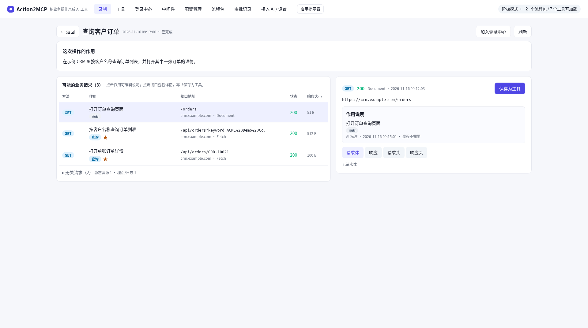
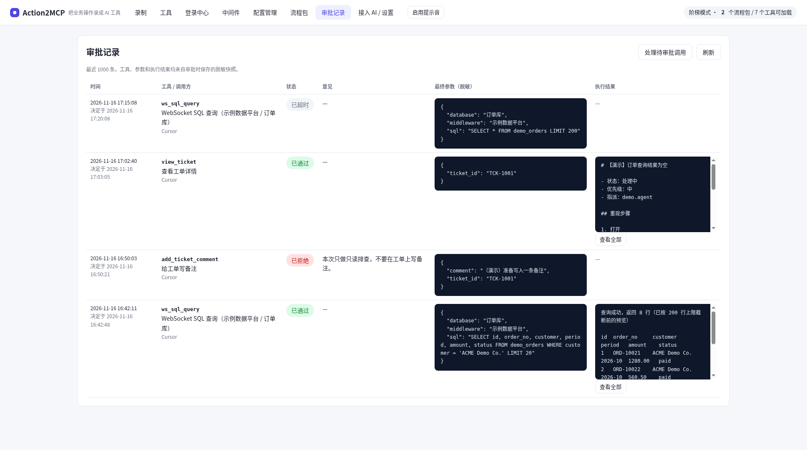

# Action2MCP

[](https://github.com/Juddy724/action2mcp/releases/latest)
[](https://go.dev/)
[](#下载与安装)
[-10b981)](#快速上手)

**把真实业务操作录制为安全可控的 AI（MCP）工具。**  
无需改造存量后台或手写胶水接口——在专用浏览器里操作一遍即可沉淀为标准化 MCP 工具，同时将数据库、缓存、消息队列与 WebSocket 终端/SQL 控制台统一纳入本地安全网关。单文件跨平台运行，凭证与数据 100% 留在本机。

<!-- version-banner:start -->
> **最新版本：v0.7.9** ｜ [国内下载（Gitee Releases）](https://gitee.com/tricycle/action2mcp/releases) ｜ [国际下载（GitHub Releases）](https://github.com/Juddy724/action2mcp/releases/latest)
> 升级时保留原 `data/` 目录和 `secret.key`，即可无缝继承已有工具、流程包与配置；内置定时更新会自动按网络环境选择国内（Gitee）或国际（GitHub）源。
<!-- version-banner:end -->

---

## 核心特性

| 能力模块 | 说明 |
| :--- | :--- |
| **浏览器无感录制** | 启动隔离专用浏览器捕获业务 HTTP / WebSocket 请求，自动折叠静态资源与埋点噪音，支持 AI 自动分析标注并一键生成参数化 MCP 工具。 |
| **自定义工具与编排** | 支持独立脚本工具与多工具串行/并行（`FLOW`）编排，内置零依赖 JS 引擎（支持正则与 `callTool()` 循环调用），并兼容本机 Python / Go / Java / Node.js / Shell。 |
| **登录中心与会话自愈** | 按域名管理登录态（企业微信 / 跨域名 SSO / 账密填表 / 手动登录），过期时后台自动重登并补获必要请求头，内置 SPA 空壳防误判与并发单飞锁。 |
| **中间件与 SQL 护栏** | 统一纳管 MySQL / OceanBase、Redis、RocketMQ / Kafka / RabbitMQ 及 WebSocket 终端 / SQL 控制台；权限**默认只读**，SQL 控制台强制只读 `SELECT`、显式 `LIMIT` 与 `EXPLAIN` 索引预检。 |
| **流程包与阶梯暴露** | 按业务场景打包工具、中间件与 Markdown SOP 使用指南；默认阶梯模式仅暴露 4 个入口工具（`list_packs` / `load_pack` / `unload_pack` / `call_pack_tool`），大幅降低上下文噪音。 |
| **人类在环审批** | 写操作与 SQL 控制台支持每次审批，提供「批准 / 在线改参批准 / 附意见拒绝」，预检前置执行，绑定请求指纹防篡改并留存脱敏审计记录。 |
| **本地优先与双源更新** | 仅监听 `127.0.0.1`，敏感密钥 AES-256-GCM 本地加密，支持双向多编码脱敏与 `.a2m` 零密文共享；内置定时版本检测，自动按国内（Gitee）/ 国际（GitHub）路由更新并一键原地升级。 |

---

## 界面预览

<table>
  <tr>
    <td width="50%">
      
      <p align="center"><b>录制降噪与保存工具</b>：自动折叠静态噪音，一键提炼为 MCP 工具</p>
    </td>
    <td width="50%">
      
      <p align="center"><b>中间件安全网关</b>：默认只读权限、SQL 预检护栏与操作审计</p>
    </td>
  </tr>
</table>

<details>
<summary>展开查看更多界面截图（流程包阶梯模式 / 人工审批记录）</summary>
<br />




</details>

---

## 下载与安装

电脑需已安装 **Google Chrome** 或 **Microsoft Edge**（录制与自动重登使用独立专用窗口，不影响日常浏览器）。

<!-- download-table:start -->
| 平台 | 国内下载（Gitee · v0.7.9） | 国际下载（GitHub · v0.7.9） |
|---|---|---|
| macOS (Apple 芯片) | [Action2MCP-0.7.9-macOS-AppleSilicon.zip](https://gitee.com/tricycle/action2mcp/releases/download/v0.7.9/Action2MCP-0.7.9-macOS-AppleSilicon.zip) | [Action2MCP-0.7.9-macOS-AppleSilicon.zip](https://github.com/Juddy724/action2mcp/releases/download/v0.7.9/Action2MCP-0.7.9-macOS-AppleSilicon.zip) |
| macOS (Intel) | [Action2MCP-0.7.9-macOS-Intel.zip](https://gitee.com/tricycle/action2mcp/releases/download/v0.7.9/Action2MCP-0.7.9-macOS-Intel.zip) | [Action2MCP-0.7.9-macOS-Intel.zip](https://github.com/Juddy724/action2mcp/releases/download/v0.7.9/Action2MCP-0.7.9-macOS-Intel.zip) |
| Windows x64 | [Action2MCP-0.7.9-Windows-x64.zip](https://gitee.com/tricycle/action2mcp/releases/download/v0.7.9/Action2MCP-0.7.9-Windows-x64.zip) | [Action2MCP-0.7.9-Windows-x64.zip](https://github.com/Juddy724/action2mcp/releases/download/v0.7.9/Action2MCP-0.7.9-Windows-x64.zip) |
| Linux x64 | [Action2MCP-0.7.9-Linux-x64.zip](https://gitee.com/tricycle/action2mcp/releases/download/v0.7.9/Action2MCP-0.7.9-Linux-x64.zip) | [Action2MCP-0.7.9-Linux-x64.zip](https://github.com/Juddy724/action2mcp/releases/download/v0.7.9/Action2MCP-0.7.9-Linux-x64.zip) |

> 也可直接访问 [Gitee Releases（国内）](https://gitee.com/tricycle/action2mcp/releases) 或 [GitHub Releases（国际）](https://github.com/Juddy724/action2mcp/releases/latest) 查看完整更新日志并下载。
<!-- download-table:end -->

> **提示**：在控制台「接入 AI / 设置」底部可随时手动切换更新源（默认 `自动：国内 Gitee / 国际 GitHub`，主源不可达时自动回退备用源）。

---

## 快速上手

1. **启动控制台**：解压后运行 `start.command`（macOS）、`start.bat`（Windows）或 `start.sh`（Linux），浏览器打开 [http://localhost:7788](http://localhost:7788)。
2. **录制或纳管能力**：
   - 在 **「录制」** 页点击开始录制，在专用浏览器完成一遍业务操作后将核心请求保存为工具；
   - 或在 **「中间件」** 页登记数据库 / Redis / MQ / WebSocket 控制台。
3. **编排流程包**：在 **「流程包」** 页将工具与中间件按场景分组、编写操作指南（SOP）并开启。
4. **接入 AI 客户端**：在 **「接入 AI / 设置」** 一键复制适配 Cursor、Claude Desktop、Codex、Claude Code 等客户端的配置：
   - **Streamable HTTP**：`http://127.0.0.1:7788/mcp`
   - **Stdio 桥接**：`a2m mcp`

更完整的命令行参数、客户端配置及升级迁移细节，请查阅压缩包内附带的 `README.md`。

---

## 安全与边界

- **本地数据隔离**：服务仅监听 `127.0.0.1` 并拦截跨站请求；所有录制记录、登录态与加密密钥（`data/a2m.db`、`data/secret.key`）仅保存在本地目录，导出 `.a2m` 不含任何密文与登录态。
- **凭据注入与尽力脱敏**：保存工具时自动剥离已识别的登录请求头并改写为 `{{secret.*}}` / `{{header.*}}` 引用；返回给 AI 的结果、审批预览与审计日志会对已登记的密钥与长 Cookie 执行多编码扫描遮罩（受扫描长度/解码深度上限约束，不能代替最小权限原则）。
- **SQL 护栏与直连约束**：SQL 控制台限制单条只读 `SELECT`（含 `WITH`）+ 显式 `LIMIT`（≤ 200 行）+ `EXPLAIN` 预检；直连数据库建议始终配置只读账号并限定允许库表。
- **人工审批边界**：工具编辑页与 SQL 控制台可配置**审批模式**（`off` / `always`，**写入工具默认**每次审批），触发时控制台弹出**待审批卡片**（**等待超时**默认 300 秒，可在「**接入 AI / 设置**」调整为 30–1800 秒）。审批仅约束**通过 MCP** 发起的 AI 调用（能直接访问 **localhost HTTP** 的本机客户端仍可**伪造请求**）；请求**已经发出后无法撤回**；**MCP 会话 DELETE** 或 **stdio 桥退出不保证取消**待审批调用（会继续等待用户**拒绝或超时**）；参数**大整数精度**受 JSON `float64` 解码范围限制。

---

## 从源码构建

需要 **Go 1.27.3+** 与 **Python 3**（用于打包）：

```bash
# 运行全量单元测试
go test ./...

# 构建当前平台二进制
go build -o a2m ./cmd/a2m

# 跨平台打包 dist/ 下全部四个平台的发布 zip（自动同步版本号并执行全量测试）
python3 build.py
```

详细的包分层职责、依赖方向与安全边界见 [架构说明（docs/architecture.md）](docs/architecture.md)；自定义工具与编排引擎设计见 [设计文档（docs/custom-tools/design.md）](docs/custom-tools/design.md)。

---

## 已知限制

- 暂不支持录制跨域 `iframe` 及 `Service Worker` 发出的请求。
- 若部分 AI 客户端未响应 `tools/list_changed` 动态刷新，可直接通过 `call_pack_tool` 调用已加载流程包中的工具。
- 流程包加载状态保存在内存中，重启 Action2MCP 后需重新 `load_pack`。
- 同机启动多个实例时，请在各自 `data/config.json` 中修改监听端口。
