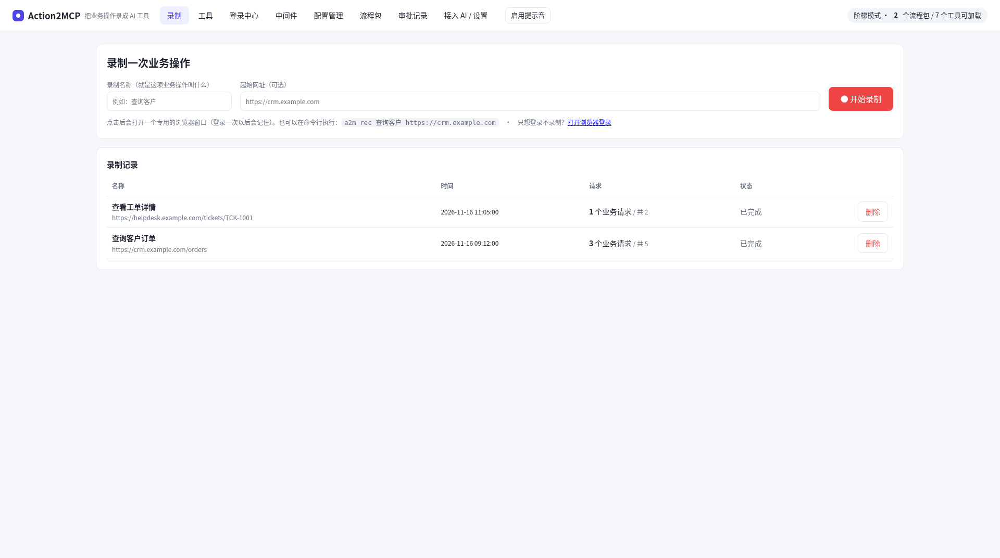
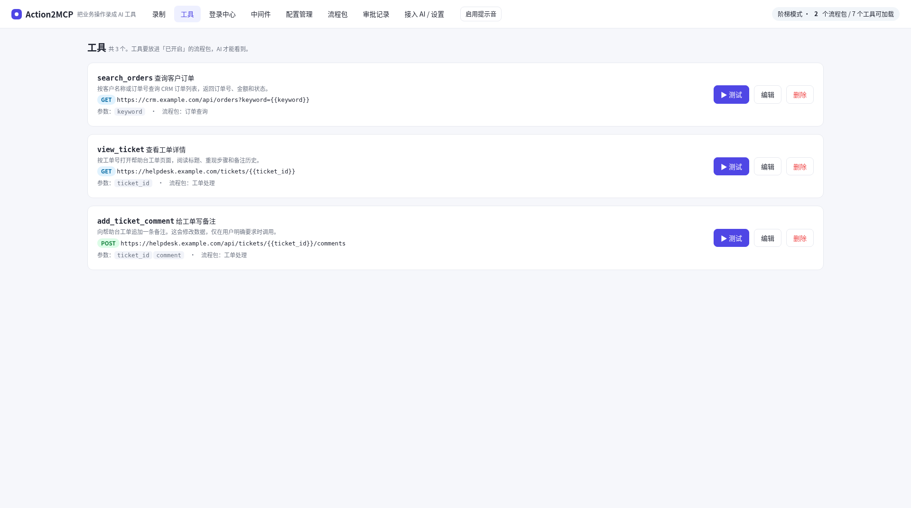
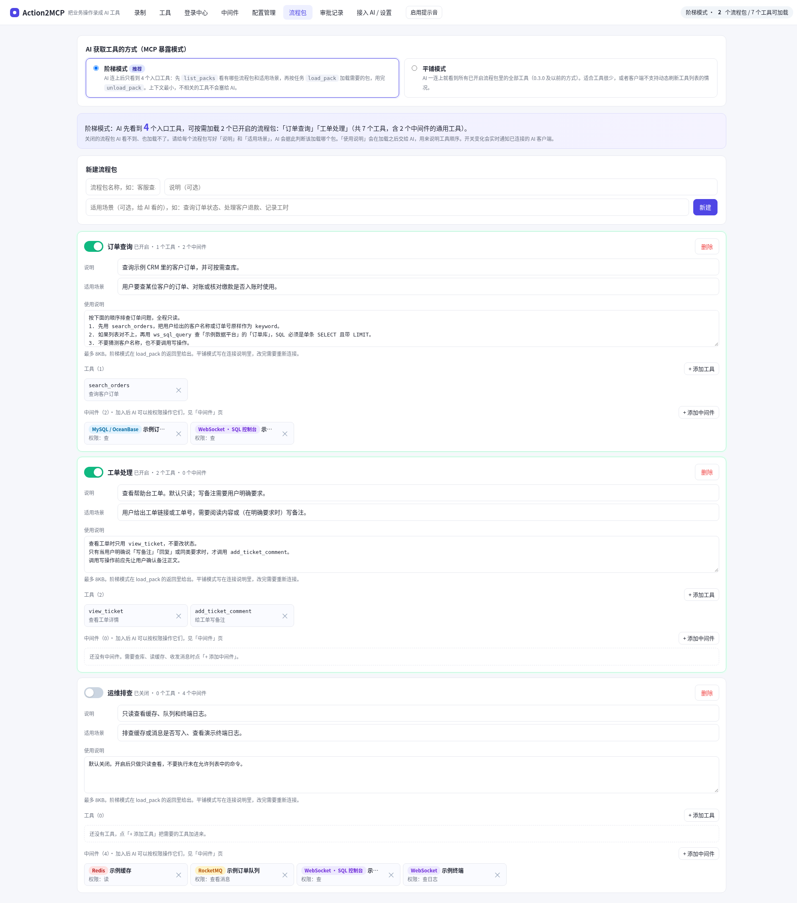
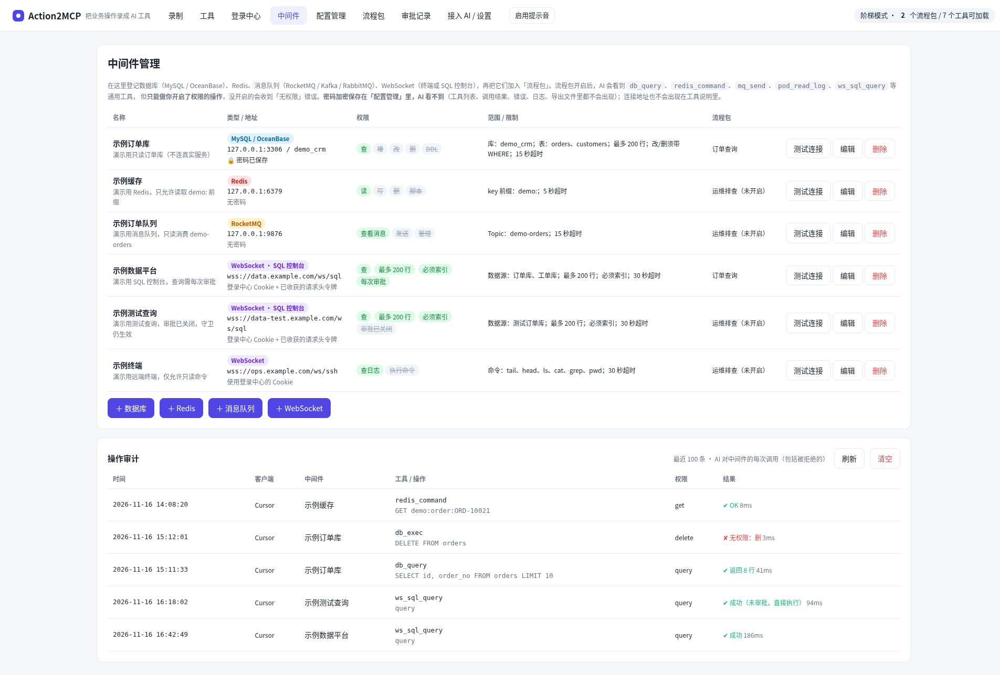

# Action2MCP

把网页上的业务操作录制下来，整理成 AI 可调用的 MCP 工具。单个可执行文件，解压即用，数据只保存在本机。

当前版本：**v0.6.0**。安装包见 [Releases](https://github.com/Juddy724/action2mcp/releases/latest)；更完整的使用说明在解压后的 README.md 里。0.6.0 只调整源码包布局和版本号，数据库、命令行和 MCP 行为与 0.5.12 相同。

## 界面预览

以下截图来自本机**演示环境**，使用虚构的 `example.com` 数据，不是真实业务系统，也不包含真实登录凭证或录制记录。

录制一次操作，业务请求会排在前面，噪音请求自动折叠；也可以给请求写上作用说明，再保存为工具：




工具、流程包和 MCP 暴露方式都在控制台里配置。流程包可以写使用说明；加载时会返回这份说明，供 AI 参考：





中间件用来把数据库、Redis、消息队列和 WebSocket（终端或 SQL 控制台）交给 AI，权限默认只读。SQL 控制台可以要求每次审批：



AI 调用需要审批时，控制台会弹出卡片；历史记录里的执行结果默认只显示预览，可以点「查看全部」看完整返回（已按同样规则脱敏）：


## 下载与启动

| 平台 | 安装包 (v0.6.0) |
|---|---|
| macOS (Apple 芯片) | [Action2MCP-0.6.0-macOS-AppleSilicon.zip](https://github.com/Juddy724/action2mcp/releases/download/v0.6.0/Action2MCP-0.6.0-macOS-AppleSilicon.zip) |
| macOS (Intel) | [Action2MCP-0.6.0-macOS-Intel.zip](https://github.com/Juddy724/action2mcp/releases/download/v0.6.0/Action2MCP-0.6.0-macOS-Intel.zip) |
| Windows x64 | [Action2MCP-0.6.0-Windows-x64.zip](https://github.com/Juddy724/action2mcp/releases/download/v0.6.0/Action2MCP-0.6.0-Windows-x64.zip) |
| Linux x64 | [Action2MCP-0.6.0-Linux-x64.zip](https://github.com/Juddy724/action2mcp/releases/download/v0.6.0/Action2MCP-0.6.0-Linux-x64.zip) |

解压后运行 `start.command`（macOS）、`start.bat`（Windows）或 `start.sh`（Linux），然后打开 [http://localhost:7788](http://localhost:7788)。电脑上需要已安装 Google Chrome 或 Microsoft Edge；录制会打开一个专用浏览器窗口，和日常使用的浏览器互不影响。

更完整的启动、命令行和客户端配置说明，见安装包里的 README.md。

## 主要功能

- **录制与保存工具**：在控制台或命令行开始录制，按平时的方式在业务网站上点一遍。程序会捕获接口请求，把静态资源、埋点等噪音折叠起来，选中有用的请求即可保存为 MCP 工具。保存时会去掉已识别的登录相关请求头（例如 Cookie、Authorization），并改写为配置引用的密钥；请求体或其他字段里未经识别的原文不会自动清除。调用时再从专用浏览器的登录态补上已识别的凭证。
- **录制分析**：可以对已接入的 AI 说「帮我把录制记录里的某某流程识别一下并保存成工具」。AI 会先看录制全貌，给业务请求写清作用，再把完成流程所需的最少请求保存成工具；你没指定流程包时会先问你。可在「接入 AI / 设置」里关闭。
- **流程包**：按场景把工具和中间件分组，用开关控制 AI 能不能看到。每个包可以写说明、适用场景，以及一份使用说明（Markdown，最长 8KB）。阶梯模式下，使用说明出现在 `load_pack` 的返回里；平铺模式写在连接说明中，改完需要重新连接。
- **MCP 接入**：Streamable HTTP（`http://localhost:7788/mcp`）或 stdio（`a2m mcp`）。默认是**阶梯模式**：AI 先只看到 `list_packs`、`load_pack`、`unload_pack`、`call_pack_tool` 四个入口，按任务加载流程包。也可以切回平铺模式，让 AI 一连上就看到所有已开启流程包里的工具。关闭的流程包 AI 看不到，也调用不了。
- **登录中心**：为每个网站保存登录方式（企业微信 / 单点登录、账号密码填表或重放、手动登录）。AI 调用时如果发现登录过期，会在后台自动重新登录再重试。录制时如果走了企业微信扫码，结束录制后可以识别并加入登录中心。等待登录最多 5 分钟，可以取消，关闭窗口也会结束等待。
- **配置管理**：账号、密码等加密保存在本机。工具和登录配置里用 `{{secret.名称}}` 引用。程序会按已登记的密钥（配置项、足够长的 Cookie 等）在 MCP 工具说明、调用结果、错误、审批预览、审计和导出里做脱敏，但这是尽力而为的扫描，受长度和解码深度等上限约束，不能保证任意位置的敏感信息都不会出现。控制台本人可以查看和编辑这些配置。
- **中间件**：登记 MySQL / OceanBase、Redis、RocketMQ / Kafka / RabbitMQ，以及 WebSocket 终端或 SQL 控制台，加入已开启的流程包后，AI 会看到 `db_query`、`redis_command`、`mq_send`、`pod_read_log`、`ws_sql_query` 等通用工具。每种操作的权限可单独开关，**默认只读**。连接密码同样进入配置管理。
- **工具审批**：在工具编辑页的「审批模式」选择不审批（off）或每次都审批（always）；写入工具默认每次都审批（`POST` / `PUT` / `PATCH` / `DELETE` / `WS`）。WebSocket SQL 控制台的审批模式可在中间件里配置为每次审批（默认）或关闭；关闭后守卫仍然生效。AI 经 MCP 调用时，控制台弹出待审批卡片，可以批准、改参数后批准，或拒绝并写下原因。等待超时默认 300 秒，可在「接入 AI / 设置」里改为 30–1800 秒。
- **WebSocket SQL 控制台**：把数据平台的「一条 WebSocket 消息执行 SQL」登记为中间件，AI 用 `ws_sql_query`（中间件名、数据源别名、SQL）查询，和直连数据库的 `db_query` 不是同一个工具。一个库由数据源 ID、envId、envType 三个值确定。`{{header.cookie}}` 从登录中心的 Cookie 罐取值；登录令牌用已收获的请求头注入，不要写进配置。
- **HTML 结果与写操作标注**：JSON 不会做 HTML 清洗，但仍受结果长度截断、已知密钥脱敏，以及（默认开启的）失败检测约束；明确的 JSON 失败会被标成工具错误。HTML 默认去掉脚本、样式和可识别的导航，转成保留结构的紧凑 Markdown；也可以改回原始 HTML，或只取某个 CSS 选择器区域。清洗后几乎为空（例如页面全靠脚本渲染）会退回原始 HTML 并附说明。页面里的错误提示也会被标成工具错误。写操作工具的 MCP 说明以「【写操作，仅在用户明确要求时调用】」开头；很多站点用 POST 做查询，可在「操作类型」里改成只读。这些选项只能在控制台改，AI 不能改。

## 使用流程

1. 启动 Action2MCP，打开控制台。
2. 在「录制」页开始录制，在专用浏览器里走完一遍业务操作，然后结束录制。
3. 打开这条录制，选中有用的请求，保存为工具，并放进一个流程包。
4. 在「接入 AI / 设置」里，把 MCP 地址或 `a2m mcp` 命令配到 Cursor、Claude Desktop、Codex、Claude Code 等客户端（控制台里有填好本机路径的配置，可直接复制）。
5. 需要查库、读缓存或走数据平台 SQL 时，在「中间件」里登记，再加入对应流程包。
6. 之后直接对 AI 描述要做的事。阶梯模式下，AI 会先看流程包列表，再加载要用的包。

## 登录、密钥与录制数据

- 保存为工具时，程序会去掉已识别的登录相关请求头（例如 Cookie、Authorization），并把已引用的配置项保存为 `{{secret.名称}}` 这类引用，而不是再存一份明文。这不表示请求里任意位置的敏感原文都会被清除。调用时使用专用浏览器里的登录态，以及登录中心收获到的必要请求头。
- 配置管理里的密钥、足够长的 Cookie 值等已知秘密，会按实现中的脱敏规则从返回给 AI 的结果、审批预览、审计和报错里遮成 `******`。脱敏是对已知模式的扫描，受长度和解码深度等上限约束，不能保证未登记或形态特殊的内容一定被遮掉。数据源 ID、envId、envType 等配置标识会从工具说明、审批预览、审计和报错里隐藏，但成功的查询结果行如果碰巧出现相同内容，会原样保留。
- 原始录制记录（含请求头）只保存在本机 `data` 目录。控制台显示时会打码，导出 `.a2m` 文件也不包含登录态。删除录制即可清除对应记录。
- 服务只监听本机地址（`127.0.0.1`），并拒绝其他网站发起的跨站请求。不要把控制台或 MCP 端口暴露到公网。

## SQL 控制台的守卫与审批

- 只允许单条只读 `SELECT`（含 `WITH`），必须带显式 `LIMIT`（最多 200 行）。执行前会另开连接做 `EXPLAIN` 索引预检；预检失败或守卫拒绝时，不会向目标发送业务 SQL。结果超过上限会截断并注明。
- 审批模式在中间件编辑页配置，可选「每次审批」（默认）或「关闭」。关闭后不再弹出审批，审计会记下「未审批，直接执行」，但只读、LIMIT、函数白名单、EXPLAIN 和行数上限仍然生效。审批模式只能在控制台改，不会出现在 MCP 工具说明里，AI 不能查看或修改。
- 审批预览按设计只包含中间件名、数据源别名和即将执行的 SQL，不展示数据源 ID、环境参数或登录令牌。
- `EXPLAIN` 只是执行前预检，不保证第二次连接的实际执行计划与预检完全一致，也不提供远端只读事务。

直连数据库的「改 / 删」权限里，「必须带 WHERE」只检查有没有 WHERE 子句，`WHERE 1=1` 也能通过。更可靠的做法是给 AI 使用只读数据库账号，并限制允许的库和表。

## 工具审批的范围与限制

- 审批只约束通过 MCP 发起的 AI 调用；能直接访问 localhost HTTP 的客户端仍可伪造请求，审批不能代替本机访问权限管理。
- 请求已经发出后无法撤回。
- MCP 会话 DELETE 和 stdio 桥退出不保证取消待审批调用；这类调用会继续等待用户拒绝或超时。
- 参数按整体替换：未提交的参数保留原值；非秘密参数原样展示、原样替换。秘密参数整体遮罩，未改动的 `******` 保留原值，输入完整新值则替换整个参数。
- 大整数精度与现有 MCP JSON 的 float64 解码路径一致，超出其精确范围的整数可能丢失精度。

## 从源码构建

需要 Go 1.27.3 或更高版本：

```
go test ./...
go build -o a2m ./cmd/a2m
python3 build.py   # 生成 dist/ 下四个平台的 zip；内部同样执行 go test ./... 与 go build ./cmd/a2m
```

你的数据（录制记录、工具、密钥）只保存在本地 `data/` 目录，不会进入仓库。

## 目前的限制

- 跨域 iframe 里的请求，以及 Service Worker 发出的请求，暂时录不到。
- 部分 AI 客户端收到 `tools/list_changed` 通知后不会刷新工具列表。这时可以用 `load_pack` 返回的信息，通过 `call_pack_tool` 调用，功能不受影响。
- 流程包的加载状态只保存在内存里，Action2MCP 重启后需要重新 `load_pack`（MCP 连接本身在重启后也需要重连）。
- Redis 集群 / 哨兵模式、TLS，以及 Kafka 的 SASL 登录已经实现，但还没有在真实的集群环境里测过。RabbitMQ 无法列出队列；查看消息后消息会退回队列，并被标记为重新投递。
- 同一台电脑上同时运行两份 Action2MCP 时，请在 `data/config.json` 里给其中一份换个端口。

中间件和升级迁移的更细说明，见安装包里的 README.md。
