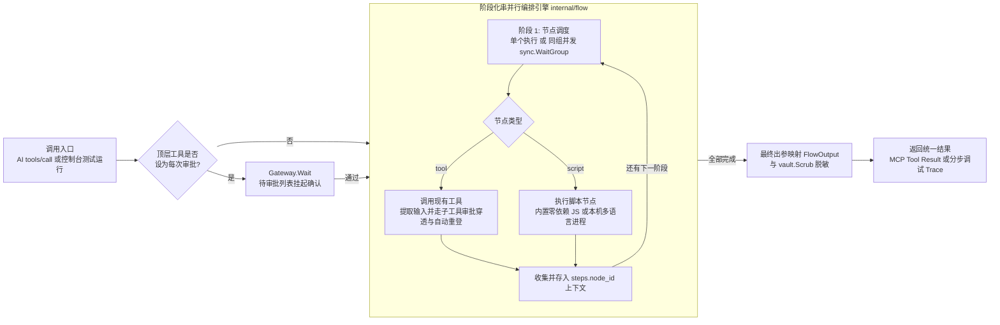

# 自定义工具与多节点编排设计文档

## 1. 背景与核心目标

在实际业务系统中，通过浏览器录制生成的大多是**原子接口工具**（例如：「按手机号查客户 ID」、「按客户 ID 查订单列表」、「按订单号查物流详情」）。如果将这些原子工具直接暴露给 AI，通常存在以下问题：

- **多轮交互耗时费 Token**：AI 需要反复发起多次 Tool Call 推理，且前序接口返回的大量冗余 JSON 字段会持续挤占上下文窗口。
- **复杂参数拼接易出错**：当多个接口的数据需要经过滤、去重、格式转换或加密计算才能组装为下一接口的入参时，仅靠 AI 推理拼接容易出错。
- **缺少本地自定义能力**：部分数据加工、本地文件/命令行处理或自定义脚本逻辑无法直接通过纯 HTTP 录制完成。

为解决上述问题，Action2MCP 引入**「自定义工具（Custom Tool / Flow）」**能力，支持在控制台内通过类 Dify 的**阶段化节点编排**将「自定义脚本」与「现有工具」组合成单一 MCP 工具暴露给 AI：

1. **场景一：独立脚本工具**
   - 支持用户直接编写完整脚本（内置零依赖 JavaScript 引擎或本机 Python / Go / Java / Node.js / Shell），定义清晰的入参及默认测试值，默认以 JSON 格式输出。
   - 编辑器内支持点击「测试运行」，自动带入默认值验证脚本执行是否正常、查看标准输出与错误日志。
2. **场景二：多工具 + 脚本串并行编排**
   - **纯串联编排**：例如 `工具 A 出参 -> 工具 B 入参 -> 工具 C 入参 -> 返回 C 出参`。AI 调用该工具时只需传入 A 的入参，即可一次性直接获得 C 的最终结果。
   - **并行汇聚 + 脚本加工**：例如 `工具 A` 与 `工具 B` 并行执行（支持从 A、B 自动提取去重后的顶层入参），经「脚本节点」提取、重组 A 与 B 的部分字段生成 C 的入参，最终调用 `工具 C` 返回结果。整个内部调用链对 AI 透明，AI 仍只需发起一次工具调用。

---

## 2. 整体架构与现有系统融合

### 2.1 执行链路架构图



### 2.2 与现有系统融合（Schema Version 保持 12）

1. **复用 `tools` 表与 `execution.Tool` 模型，无数据库迁移风险**：
   - 不修改 `internal/store` 的 SQLite 表结构（保持 `user_version = 12`）。
   - 在 `execution.Tool` 中新增请求/执行类型 `Method = "FLOW"`（独立脚本工具本质上是“仅包含 1 个脚本节点的 FLOW 工具”，底层统一为同一套存储与执行模型，前端可提供“新建脚本工具 / 新建组合编排”两种引导模板）。
   - 编排定义以 JSON 结构保存在 `Tool.Config.Flow`（`*execution.FlowConfig`）字段中，URL 在 `FLOW` 模式下可统一规范为展示标识 `flow://custom`。
2. **全面复用现有能力**：
   - **流程包与阶梯发现**：支持放入任意流程包（Packs），`list_packs`、`load_pack`、`call_pack_tool`、`unload_pack` 无需特殊适配即可直接使用。
   - **`.a2m` 导入导出**：脚本源码与编排拓扑随 `Tool.Config` 一同保存在工具定义中，`internal/transfer` 导出后，同事导入即可分享整套自定义工作流与脚本（Vault 机密引用继续保持脱敏占位）。
   - **MCP Schema 自动生成**：对外入参复用 `Tool.Params` 与 `Tool.InputSchema()` / `McpInputSchema()`。

### 2.3 包职责与依赖边界

遵循 `docs/architecture.md` 的依赖方向约束（并同步更新 `TestFeaturePackageDependencyDirection` 允许清单）：

| 模块 | 职责说明 |
|---|---|
| `internal/execution` | 扩展 `ToolConfig` 增加 `Flow *FlowConfig`（及配套类型定义）；更新 `Tool.Normalize()` 放行 `Method == "FLOW"`，无需校验 `http://`/`ws://`。 |
| `internal/flow`（新增） | 核心编排与脚本运行时包：包含本机运行环境探测（`RuntimeDetector`）、内置 JS 引擎与外部语言脚本执行器（`ScriptRunner`）、模板变量绑定与 JSON 路径解析、分阶段串并行调度器（`Executor`）。仅通过狭窄的回调/接口调用子工具与 Vault，不直接耦合 `store`/`app`。 |
| `internal/catalog` | 扩展 `Validate` 对 `FLOW` 工具进行基本节点校验（如节点 ID 唯一性、节点非空等）；保存时触发 `toolsChanged` 通知 MCP 客户端刷新列表。 |
| `internal/mcpserver` | 处理 `Method == "FLOW"` 工具的 `tools/call` 路由，交由 `internal/flow` 编排执行（跳过直接 HTTP/WS `Prepare`/`Send`）。 |
| `internal/console` | 新增 `/api/runtimes`（本机环境监测）与 `/api/tools/flow/test`（支持未保存/已保存草稿的带 Trace 分步测试），并使 `POST /api/tools/{id}/run` 兼容 `FLOW` 工具。 |
| `internal/app` | 在 `compose.go` 中作为组合根注入依赖（子工具调用、审批网关、Vault 解析/脱敏），不放业务逻辑代码。 |
| `web` | 在「工具」页增加「＋ 新建自定义工具」入口，实现编排编辑器、环境状态提示条、一键提取去重入参，以及底部节点级分步测试面板。 |

---

## 3. 数据模型与 JSON 协议设计

### 3.1 Go 数据结构规划

`ToolConfig` 新增 `Flow *FlowConfig` 字段（位于 `internal/execution` 或公共定义包中，由 `ToolConfig` 引用）：

```go
type FlowConfig struct {
	Steps  []FlowStep `json:"steps"`            // 按顺序执行的节点列表
	Output FlowOutput `json:"output,omitempty"` // 最终出参配置
}

type FlowStep struct {
	ID               string         `json:"id"`                           // 节点唯一标识，如 step_a、merge_ab
	Name             string         `json:"name,omitempty"`               // 节点显示名称
	Kind             string         `json:"kind"`                         // "tool" | "script"
	ParallelWithPrev bool           `json:"parallel_with_prev,omitempty"` // true 表示与上一节点处于同一并行阶段

	// Kind == "tool" 时使用
	ToolName string         `json:"tool_name,omitempty"` // 目标工具标识（录制工具或中间件工具）
	Args     map[string]any `json:"args,omitempty"`      // 子工具入参映射表（字面值或模板）

	// Kind == "script" 时使用
	Runtime string `json:"runtime,omitempty"` // builtin_js | python | go | java | node | shell
	Code    string `json:"code,omitempty"`    // 完整脚本源码
}

type FlowOutput struct {
	Mode     string `json:"mode,omitempty"`     // "last"（默认取最后节点或最后阶段输出） | "template"
	Template string `json:"template,omitempty"` // 自定义输出模板，如 "{{steps.step_c.data}}" 或 JSON 模板
}
```

### 3.2 典型编排 JSON 示例（A、B 并行 -> 脚本加工 -> 调用 C）

```json
{
  "name": "query_order_logistics_combo",
  "title": "按手机号和商户查物流详情",
  "description": "根据手机号和商户编码一次性查询订单与物流轨迹",
  "method": "FLOW",
  "url": "flow://custom",
  "approval": "off",
  "params": [
    {"name": "mobile", "type": "string", "required": true, "default": "13800138000", "description": "用户手机号"},
    {"name": "merchant_code", "type": "string", "required": true, "default": "M001", "description": "商户编码"}
  ],
  "config": {
    "flow": {
      "steps": [
        {
          "id": "step_a",
          "name": "查询用户信息",
          "kind": "tool",
          "tool_name": "get_user_by_mobile",
          "args": {
            "phone": "{{input.mobile}}"
          }
        },
        {
          "id": "step_b",
          "name": "查询商户配置",
          "kind": "tool",
          "parallel_with_prev": true,
          "tool_name": "get_merchant_info",
          "args": {
            "code": "{{input.merchant_code}}"
          }
        },
        {
          "id": "step_merge",
          "name": "组装查询参数",
          "kind": "script",
          "runtime": "builtin_js",
          "code": "function main(input, steps) {\n  return {\n    uid: steps.step_a.data.userId,\n    region: steps.step_b.data.regionCode,\n    traceTag: input.merchant_code + '-' + steps.step_a.data.userId\n  };\n}"
        },
        {
          "id": "step_c",
          "name": "获取最终物流",
          "kind": "tool",
          "tool_name": "get_logistics_detail",
          "args": {
            "userId": "{{steps.step_merge.uid}}",
            "region": "{{steps.step_merge.region}}"
          }
        }
      ],
      "output": {
        "mode": "template",
        "template": "{{steps.step_c.data}}"
      }
    }
  }
}
```

---

## 4. 脚本运行时双层设计与环境自动监测

为兼顾**“开箱即用、零环境依赖传播”**与**“多语言复杂编程生态”**，脚本执行器采用双层设计：

### 4.1 第一层：内置零依赖引擎（默认首选项 `builtin_js`）

- **选型**：在 Go 二进制内部集成纯 Go 实现的 ECMAScript (ES5/ES6) 引擎（如 `github.com/dop251/goja`，支持 `CGO_ENABLED=0` 静态交叉编译，不依赖本机 Node.js，不引入 CGO）。
- **优势**：
  - 用户导出 `.a2m` 给任意同事（Windows / macOS Apple Silicon / macOS Intel / Linux），无需对方安装任何语言运行时或配置环境变量，数据清洗、字段重组、签名拼接类脚本 100% 直接可跑。
- **执行约定**：
  - 运行前注入只读上下文变量 `input`、`steps`（及服务端替换好的 `{{cfg.*}}`/`{{secret.*}}`）。
  - 若脚本定义了 `main(input, steps)` 函数，自动调用并取其返回值序列为 JSON；若未定义 `main`，则读取脚本最后一个表达式结果或 `console.log` 输出的 JSON。

### 4.2 第二层：本机外部多语言环境

支持用户在本机环境执行完整脚本源文件，支持的运行时如下：

| 运行时标识 | 探测命令 | 临时文件执行方式 | 适用场景 |
|---|---|---|---|
| `python` | `python3`（回退 `python`） | `python3 <tmp>/script.py` | 复杂算法、数据处理、文本解析 |
| `go` | `go` | `go run <tmp>/main.go` | 高性能逻辑、复用 Go 标准库 |
| `java` | `java`（需 JDK 11+） | `java <tmp>/Main.java`（单文件源码直接启动） | 复用 Java 逻辑/加密验证 |
| `node` | `node` | `node <tmp>/script.mjs` 或 `.js` | 使用本地 `npm` 生态或现代 JS 特性 |
| `shell` | `bash`（回退 `sh`） | `bash <tmp>/script.sh`（Windows 可选 `powershell`） | 调用系统命令或本地脚本工具 |

#### 统一输入输出契约（Stdin / Env JSON -> Stdout JSON）

1. **输入传递**：
   - 执行器在临时工作目录生成上下文文件 `context.json`，结构为 `{"input": {...}, "steps": {...}}`。
   - 启动脚本子进程时，通过 **标准输入（`stdin`）** 传入该完整 JSON，同时设置环境变量 `A2M_CONTEXT_FILE=<context.json 路径>`，方便各种语言通过 `sys.stdin`、`os.Stdin` 或读取文件轻松获取前序节点结果。
2. **输出解析**：
   - 脚本默认将最终结果序列化为 JSON 打印到 `stdout`。
   - 执行器先尝试将完整 `stdout` 解析为 JSON；若用户在调试过程中前面使用了 `print`/`fmt.Println` 输出多行日志，则自动提取**最后一行合法 JSON** 作为节点出参（若整段 `stdout` 非 JSON，则返回原始文本包在 `{"text": ...}` 中或作为错误提示，确保可观测性），同时完整保留 `stdout`/`stderr` 在测试面板中展示。
3. **脚本源码与安全边界**：
   - 脚本中的 `{{cfg.名称}}` / `{{secret.名称}}` 引用在落入临时代码前由服务端完成替换注入（或在安全上下文对象中提供），且临时目录在当次节点执行完毕后立即清理。
   - **设计取舍**：脚本内部的递归深度、循环终止逻辑等常规编码责任由脚本编写者自行把控，系统不在外层强加多余的死循环或递归截断兜底，保持执行流程简单直接。

### 4.3 运行环境自动监测与用户提示

1. **环境探测 API：`GET /api/runtimes`**
   - 扫描系统 `PATH`（通过 `exec.LookPath`）并读取版本信息（`python3 --version`、`go version`、`java -version`、`node -v`、`bash --version`）。
   - 在 macOS GUI 启动场景下，兼容补充常见默认安装目录（如 `/opt/homebrew/bin`、`/usr/local/bin`）的探测与提示，并明确区分**当前服务进程实际可见的 `PATH`**。
   - 返回示例：
     ```json
     [
       {"id": "builtin_js", "label": "JavaScript (内置零依赖)", "available": true, "builtin": true, "version": "ES6 Built-in"},
       {"id": "python", "label": "Python", "available": true, "path": "/opt/homebrew/bin/python3", "version": "Python 3.12.2"},
       {"id": "go", "label": "Go", "available": false, "hint": "未在环境变量 PATH 中检测到 go，请先安装 Go 并配置 PATH 后重启服务"},
       {"id": "java", "label": "Java", "available": false, "hint": "未在环境变量 PATH 中检测到 java，请先安装 JDK 并配置 JAVA_HOME/PATH"}
     ]
     ```
2. **前端提示与执行阻断**：
   - 在编辑器中切换到对应脚本语言时，语言下拉框下方立即渲染环境检测徽章：
     - 就绪：`✓ 已检测到 Python 3.12.2`
     - 缺失：`⚠ 当前电脑未检测到 Go 环境或未配置 PATH 环境变量（点击「使用内置 JS」可免环境运行）`
   - 若用户仍对缺失环境的语言点击「测试运行」或由 AI 触发调用，后端直接返回明确的环境缺失提示信息，不发生模糊报错。

---

## 5. 串并行编排引擎与参数映射机制

### 5.1 分阶段（Stage）串并行调度模型

为保证编排可视化清晰、无需引入复杂的图形连线拖拽算法，采用**有序步骤列表 + `parallel_with_prev` 标志**生成执行阶段（Stage）：

1. **阶段划分规则**：
   - 从第一个节点开始，若当前节点的 `parallel_with_prev == true`，则归入**当前 Stage**；否则开启一个新的 Stage。
   - 例如步骤 `[A(false), B(true), M(false), C(false)]` 自动划分为：
     - **Stage 1（并行）**：`[A, B]`（启动 2 个 Goroutine + `sync.WaitGroup` 并发执行）
     - **Stage 2（串行）**：`[M]`（等待 Stage 1 全部完成并汇总后执行）
     - **Stage 3（串行）**：`[C]`（等待 Stage 2 完成后执行）
2. **上下文汇总与错误中断**：
   - 运行态维护线程安全的上下文 `stepsMap map[string]any`（加 `sync.RWMutex` 保护）。
   - 若子工具返回的 HTTP/WS 响应本身为 JSON 字符串，自动反序列化存入 `steps.<节点id>`，以便后续直接用点路径提取深层字段；若为纯文本/Markdown，则以字符串或 `{"text": ...}` 形式提供。
   - 同一 Stage 内任一节点返回错误时，在当前 Stage 结束等待后立即中止后续 Stage，并在测试 Trace 中高亮定位出错节点与原因。

### 5.2 模板变量解析与类型保持

支持在工具节点参数值与最终输出模板中使用统一占位符语法：

- `{{input.<参数名>}}`：引用顶层自定义工具的入参值。
- `{{steps.<节点ID>.<点分路径>}}`：引用前置已完成节点的出参（支持嵌套字段与数组下标，如 `{{steps.step_a.data.items.0.id}}`）。
- `{{cfg.<配置名>}}` / `{{secret.<密钥名>}}`：引用「配置管理（Vault）」里的配置值或密钥。

**类型保真规则**：
- 若参数模板值**整体**就是一个占位符（例如 `args["user_ids"] = "{{steps.merge.ids}}"`），解析后**直接保留原始 JSON 类型**（数组、对象、数字、布尔值）传给下游工具。
- 若占位符嵌入在字符串中（例如 `"订单-{{steps.step_a.orderNo}}"`），则按字符串格式化拼接。

### 5.3 从子工具一键提取并去重入参

针对“并行调用 A 和 B，再汇聚成 C”的常见场景，提供前端辅助能力：
- 编辑器顶部入参区提供**「从编排工具提取入参」**按钮；
- 扫描所有已选的 `kind == "tool"` 节点对应目标工具的 `Params`：
  - 按参数名（`name`）自动去重；
  - 自动填充参数类型（`type`）、是否必填（`required`）、说明（`description`）及示例默认值（`default`）；
  - 同时自动在该子工具节点的 `args` 中填入对应的 `{{input.<参数名>}}` 绑定，极大减少手工配置工作量。

---

## 6. 安全、审批穿透与脱敏机制

### 6.1 两级审批穿透机制

不能因为把一个高危写操作工具封装进自定义流程里，就绕过原有的操作审批安全网关：

1. **外层自定义工具审批**：
   - 自定义工具自身可配置 `approval`（`off` / `always`）。
   - 若设为 `always`，MCP 暴露 `inputSchema` 时按现有逻辑自动注入必填参数 `operation_note`（操作解释说明与影响分析），在整个流程执行前先进入控制台「待审批列表」等待用户批准。
2. **内部子工具审批穿透（核心）**：
   - 当外层 `FLOW` 设为 `off`，但流程第 3 步调用的已有工具 `C` 设为 `always`（例如前置 A、B 负责查询组装数据，最后一步 C 执行删除或修改）时：
   - 编排引擎运行至节点 `C` 并已完成 A、B 的真实入参计算后，**先复用 `execution.Engine.Prepare` 生成 C 的真实请求预览，并通过 `invoke.Gateway.Wait` 在控制台「待审批列表」挂起等待人工审批**（外层 MCP 工具传来的 `operation_note` 或默认步骤说明透传给本次审批记录）。
   - 用户确认后，再执行子工具 C 并完成收尾；若用户在待审批列表拒绝或超时，整个流程随即按审批拒绝结束。
3. **自动重登与登录态复用**：
   - 编排中调用现有 HTTP / WebSocket 工具时，完整复用 `execution.Engine.Send` 的 Cookie、请求头注入及登录过期自动重登重试机制。

### 6.2 密钥保护与出参脱敏

- 测试面板展示的每一步 `Trace`（实际入参、出参、`stdout`、`stderr`）、保存的工具失败错误信息、以及返回给 AI 的最终结果，一律在返回前经 `vault.Scrub()`（以及已解析的 secret 值列表）做全量脱敏，确保 `{{secret.*}}` 与站点凭证绝不泄漏到前端日志或 AI 上下文。

---

## 7. 控制台交互与分步测试设计

### 7.1 「工具」列表入口

- 在控制台顶部「工具」页标题栏右侧新增 **「＋ 新建自定义工具」** 主按钮（附快捷引导选项：空白组合编排 / 单个自定义脚本）。
- 工具列表卡片中，对 `Method == "FLOW"` 的工具展示专属标签徽章（如 `FLOW` 或 `SCRIPT`）及包含节点数摘要（例：`共 4 个节点 · 支持并行`）。

### 7.2 自定义工具编辑器结构

编辑弹框（或独立宽幅编辑视图）按自上而下的工作流顺序分为五个区域：

1. **基础信息区**：工具标识（英文/数字/下划线）、显示名称、用途说明（给 AI 看）、审批模式、默认加入流程包。
2. **对外入参定义区**：支持添加/删除参数（名称、类型 `string`/`number`/`integer`/`boolean`、必填开关、说明、**默认测试值**），提供「从已选工具一键提取去重入参」快捷按钮。
3. **节点编排区（类 Dify 卡片流）**：
   - 按顺序渲染节点卡片，支持**上移 / 下移 / 删除**，以及在底部点击 **「＋ 添加工具节点」** 或 **「＋ 添加脚本节点」**。
   - 每个非首节点左上角提供开关 **「与上一节点并行执行」**，开启后可视化视觉分组提示二者属于同一并行 Stage。
   - **工具节点卡片**：搜索选择目标工具、展开该工具所需参数表格（右侧提供快捷插入 `{{input.xxx}}` / `{{steps.xxx}}` 变量标签辅助点击填入）。
   - **脚本节点卡片**：选择运行语言（优先选中 `builtin_js`）、**实时环境检测提示条**、带默认读写 JSON 示例代码的多行代码编辑器（支持一键插入语言模板）。
4. **最终出参配置区**：单选「默认使用最后一个节点出参」或「自定义输出路径/JSON 模板」（提示可写 `{{steps.节点id.字段}}`）。
5. **实时「▶ 测试运行」与分步调试结果区**：
   - 点击 **「▶ 测试运行（使用参数默认值）」** 后，即使工具尚未保存也可以直接试跑整个流程（后端执行 `/api/tools/flow/test`）。
   - 运行完成后，在每个节点卡片旁及底部调试面板分步展示：
     - 状态徽章（`成功` / `跳过` / `失败`）与单步耗时（如 `142 ms`）；
     - 该节点实际接收到的输入 JSON；
     - 该节点返回的原始输出 JSON 与脚本 `stdout`/`stderr`；
     - **最终合并输出预览**（与 AI 实际收到的完全一致）。

---

## 8. 后端接口规划与分阶段实施路线

### 8.1 新增 / 扩展 HTTP 接口

| 方法与路径 | 用途 | 请求 / 响应要点 |
|---|---|---|
| `GET /api/runtimes` | 检测本机可用的脚本运行环境 | 返回各语言 ID、名称、是否可用、`PATH` 路径、版本号及未检测到环境变量时的友好提示文案。 |
| `POST /api/tools/flow/test` | 在编辑器内试跑未保存/已修改的自定义工具 | 请求体包含完整 `tool` 定义与 `args`（默认读取各参数 `default` 值）；响应返回 `ok`、`duration_ms`、`final_output`、`error`，以及按执行顺序排列的 `steps_trace`（含每步 `id`、`stage`、`status`、`duration_ms`、`input`、`output`、`logs`、`error`）。 |
| `POST /api/tools/{id}/run` | 运行已保存的工具 | 扩展支持 `Method == "FLOW"`：除常规响应字段外，附带 `steps_trace` 与 `final_output` 供前端「测试」弹窗渲染分步详情。 |

### 8.2 分阶段实施计划

1. **Phase 1：数据模型与运行环境探测（`internal/execution` + `internal/flow`）**
   - 定义 `FlowConfig`、`FlowStep`、`FlowOutput` 结构并扩展 `execution.ToolConfig` 与 `Normalize()`；
   - 实现 `internal/flow` 中的 `DetectRuntimes()` 与内置零依赖 JS 引擎及外部多语言进程执行器（含 `stdin`/`A2M_CONTEXT_FILE`/`stdout`/`stderr` 协议与测试）。
2. **Phase 2：串并行编排引擎与审批穿透（`internal/flow` + `internal/mcpserver` + `internal/app`）**
   - 实现分阶段（Stage）并发调度、模板变量与 JSON 路径解析（含类型保真）、工具节点执行（穿透子工具审批与自动重登）及 `vault.Scrub` 脱敏；
   - 接入 `mcpserver` 的 `tools/call` 调度，补全端到端单元测试与 `architecture_test.go` 边界检查。
3. **Phase 3：控制台接口与编排调试 UI（`internal/console` + `web`）**
   - 实现 `/api/runtimes` 与 `/api/tools/flow/test`；
   - 在前端「工具」页实现自定义工具编排编辑器、环境变量实时检测提示、一键去重提取入参、语言代码模板及分步 Trace 测试面板，并完成完整编译与本地部署验收。
